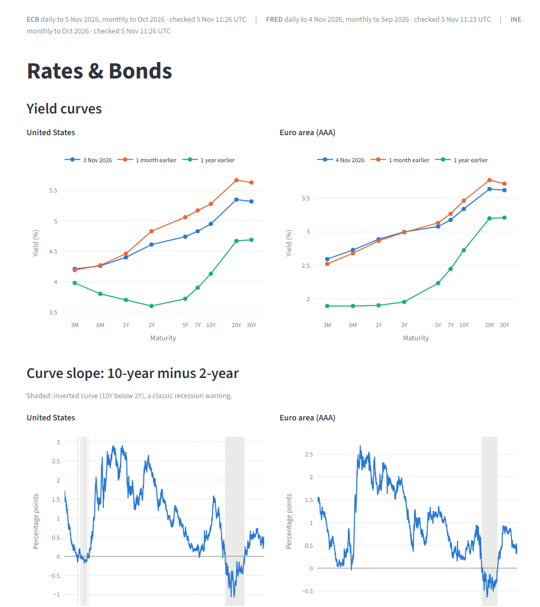
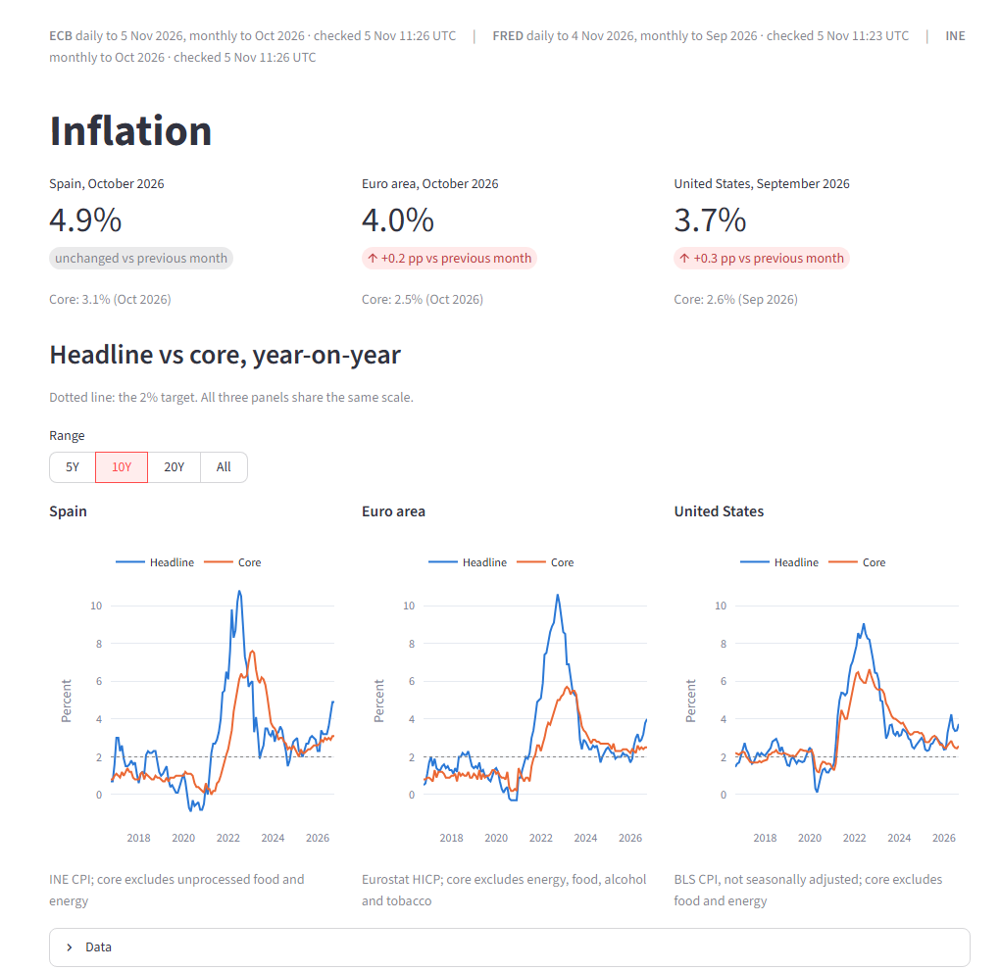
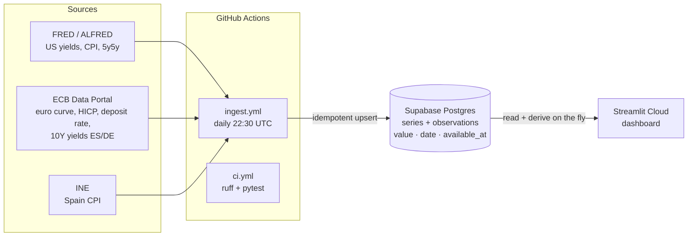

# macro-regime-dashboard

[](https://github.com/jaimecastillocolombas/macro-regime-dashboard/actions/workflows/ci.yml)
[](https://github.com/jaimecastillocolombas/macro-regime-dashboard/actions/workflows/ingest.yml)

**A self-updating macro dashboard for rates, bonds and inflation in the US, the euro area and Spain, built so that it can later drive a regime-rotation strategy without look-ahead bias.**

**Live demo: [macro-regime-dashboard-student.streamlit.app](https://macro-regime-dashboard-student.streamlit.app)** (free hosting: the first visit may take ~30 s to wake the app up).



## The problem

Macro data is scattered across central banks and statistics offices, each with its own API, format and publication calendar. A dashboard that just plots the latest numbers is easy. Using the same data to test an investment strategy is harder: a backtest must only see what was **public on each day**. US CPI for September, for example, is only known in mid-October, and revisions must not leak into the past.

This project solves both. Every night it collects the data, stores *when* each value became public next to *what* it says, and serves a dashboard on top.

## What it shows

| Page | Contents |
|---|---|
| **Rates & Bonds** | US Treasury and euro area AAA yield curves (3M to 30Y) today vs 1 month and 1 year earlier; 10Y-2Y slope with inversions shaded; Spain-Germany 10-year risk premium |
| **Inflation** | Headline vs core for Spain, the euro area and the US against the 2% target; US 5y5y market inflation expectations |

A header on every page states how recent each source is and flags any source the pipeline has not refreshed for more than 36 hours.



## Architecture



- **`src/ingest/`**: one module per source plus a shared HTTP session with timeouts and retries. `run.py` ingests every series, keeps going when one fails, prints a summary and exits non-zero so the scheduled run is flagged.
- **`src/db.py`**: two tables, `series` (metadata) and `observations` (`series_id`, `date`, `value`, `available_at`, `retrieved_at`), written with an `INSERT ... ON CONFLICT` upsert that works on SQLite locally and Postgres in production.
- **`src/transform/`**: pure, tested functions (spreads, year-on-year rates, curve snapshots). Derived series are computed on read, not stored.
- **`app/`**: the Streamlit app. It only loads, caches and plots; all logic lives in `src/`.

## Design decisions worth knowing

- **`date` and `available_at` are never mixed.** `available_at` is when a value became public:
  - US CPI uses its real first-release date from ALFRED's vintage history.
  - Daily yields use the next business day of the publisher's calendar (US federal holidays for FRED, TARGET2 for the ECB).
  - For sources without release history, a documented, conservative lag applies, capped by the day the value was first downloaded.
- **Derived series inherit the latest `available_at` of their inputs,** so filtering a spread or a y/y rate at date *t* equals computing it from inputs filtered at *t*.
- **Not seasonally adjusted US CPI.** 88-91% of the seasonally adjusted history has been revised since first release; the NSA core index barely moves (3.4% of values, at most 0.2 index points).
- **Revisions move availability.** If a stored value changes, its `available_at` moves to the new release, so a backtest cannot see the revised figure earlier.
- **Secrets stay out of logs.** FRED only accepts its key in the URL; error messages and retry warnings are redacted before they reach the public CI logs.
- **Least privilege in production.** The app connects as a database role that can only use its own schema.

## Data sources

| Source | Series | Frequency |
|---|---|---|
| [FRED](https://fred.stlouisfed.org/) (St. Louis Fed) | Treasury yields 3M-30Y, 10Y-2Y and 10Y-3M spreads, 5y5y inflation expectations, CPI and core CPI (NSA) | daily / monthly |
| [ECB Data Portal](https://data.ecb.europa.eu/) | Euro area AAA yield curve 3M-30Y, deposit facility rate, HICP (euro area headline and core, Spain), 10-year government yields for Spain and Germany | daily / monthly |
| [INE](https://www.ine.es/) | Spain CPI and core CPI, annual rate (base 2025) | monthly |

## Run it locally

Requires Python 3.11 and a free [FRED API key](https://fred.stlouisfed.org/docs/api/api_key.html).

```bash
git clone https://github.com/jaimecastillocolombas/macro-regime-dashboard.git
cd macro-regime-dashboard
python -m venv .venv
.venv/Scripts/activate              # Windows; use `source .venv/bin/activate` on macOS/Linux
pip install -r requirements.txt
cp .env.example .env                # then add your FRED_API_KEY
python -m src.ingest.run            # ~2 minutes; loads everything into data/macro.db (SQLite)
streamlit run app/streamlit_app.py
```

Tests and linting, as run in CI:

```bash
pytest
ruff check . && ruff format --check .
```

Tests never call the real APIs: they run on saved responses in `tests/fixtures/`.

## Stack

Python 3.11 · pandas · SQLAlchemy 2 · Streamlit · Plotly · Postgres (Supabase) · GitHub Actions · pytest · ruff

## Roadmap

- **Phase 1 (current):** rates, bonds and inflation, deployed and updating daily. Still to come: an overview start page with the key charts.
- **Phase 2:** equity markets by country, risk premia for more euro countries, fear gauges (VIX, credit spreads, ECB financial stress index) and a news board with sentiment scored by FinBERT.
- **Phase 3:** a regime-rotation strategy backtested walk-forward on point-in-time data, with transaction costs and a 60/40 benchmark.
